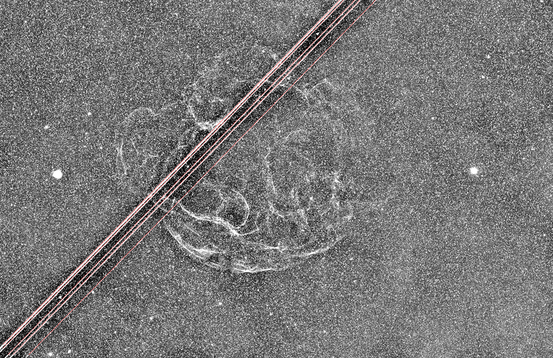

# StarlinkSweeper

**Un script PixInsight qui trouve les brutes traversées par des traînées de satellites, pour les
écarter de l'intégration.** Tu le pointes sur le dossier de tes brutes, tu lances le scan, tu
vérifies chaque brute suspecte sur un aperçu avec la traînée tracée en rouge, puis tu la mets en
quarantaine ou tu l'effaces. Une version en ligne de commande (Python) fait la même chose par lots.

*Balaie les traînées que la constellation d'un certain milliardaire laisse sur tes brutes.*

*English version: [README.md](README.md)*



*Un train Starlink sur une vraie brute bande étroite. Binnée, fond soustrait, étirée ; les traînées
détectées sont tracées en rouge.*

## Pourquoi

Le rejet par sigma-clipping (Astro Pixel Processor, ImageIntegration de PixInsight, Siril...)
supprime le **cœur** d'une traînée de satellite, mais pas ses **ailes** : à quelques pixels du
centre, la traînée n'est que légèrement au-dessus du bruit de la brute, sous n'importe quel kappa
raisonnable. Quand il n'y a pas assez de brutes pour les noyer, ces ailes subsistent dans le master
sous la forme d'une bande rectiligne faible, invisible sur les données linéaires, flagrante dès
qu'on étire fort. Le score qualité du logiciel de prétraitement ne la voit pas non plus : une
traînée ne change ni le nombre d'étoiles, ni la FWHM, ni la rondeur, donc la brute est gardée.

Quand on n'a pas assez de brutes, la meilleure solution est de virer la brute contaminée de
l'intégration. StarlinkSweeper la trouve.

## Ce qu'il fait

1. **Scan.** Chaque brute (light) FITS / XISF du dossier choisi (sous-dossiers compris) est
   binnée, son fond soustrait, puis parcourue à la recherche de lignes droites dans toutes les
   directions. Les flats, darks et bias présents dans l'arborescence sont reconnus à leur en-tête
   et ignorés : le dossier d'une nuit entière se scanne tel quel. Compter quelques secondes par
   brute de 60 Mpx.
2. **Liste.** Les brutes dont la meilleure traînée dépasse le seuil sont listées, la plus forte en
   premier, avec l'angle de la traînée et la fraction du champ qu'elle couvre. Un train Starlink
   apparaît comme plusieurs lignes parallèles au même angle.
3. **Vérification.** Un clic sur une brute l'affiche dans l'aperçu, les traînées détectées tracées
   en rouge sur leur étendue détectée ; un double-clic ouvre la brute en pleine résolution dans
   PixInsight.
4. **Action.** **Quarantine** déplace la brute dans un sous-dossier `_trails` à côté d'elle
   (réversible, à la main). **Erase** la supprime définitivement, après une confirmation à chaque
   fois. **Quarantine red** déplace toutes les brutes affichées en rouge (score au niveau *Red
   above* ou au-dessus), **Quarantine all listed** toute la liste. **Export CSV** écrit le score de
   toutes les brutes scannées.

Le curseur de seuil refiltre la liste sans relancer le scan. Les brutes elles-mêmes ne sont jamais
modifiées ; celles qui sont déjà dans un dossier `_trails` sont ignorées.

## Prérequis

| Fichier | PixInsight |
|---|---|
| `scripts/StarlinkSweeper.js` (1.0.5) | 1.9.4 et suivants |

Entrée : brutes FITS ou XISF, mono ou CFA (lues brutes), calibrées ou non.

La version en ligne de commande, `python/starlinksweeper.py`, nécessite Python 3 avec `numpy`,
`scipy` et `astropy`.

## Installation

### Depuis le dépôt de mises à jour PixInsight (recommandé)

1. *Resources > Updates > Manage Repositories*, ajouter
   `https://jps-34.github.io/StarlinkSweeper/`
2. *Resources > Updates > Check for Updates*, puis redémarrer PixInsight.
3. Le script apparaît dans *Script > Utilities > StarlinkSweeper*.

Tant que le dépôt n'est pas signé, PixInsight ne l'accepte qu'avec la préférence de sécurité
*Allow unsigned update repositories* activée.

### Manuelle

Télécharger `scripts/StarlinkSweeper.js`, puis soit l'exécuter avec *Script > Execute Script
File*, soit ajouter son dossier avec *Script > Feature Scripts > Add* pour qu'il apparaisse dans le
menu *Script > Utilities*.

## Prise en main

1. **Lights folder** : choisir le dossier racine des brutes (un filtre, une cible ou toute la
   nuit, peu importe). *Include sub-folders* est coché par défaut.
2. **Scan**. La progression s'affiche dans la boîte et dans la console ; **Stop** interrompt
   proprement.
3. Parcourir la liste : cliquer sur une brute, regarder l'aperçu, puis **Quarantine** ou
   **Erase**.
4. Relancer l'intégration sans les brutes en quarantaine.

À lancer avant l'intégration, sur les brutes calibrées ou non. Si un master montre déjà une bande
rectiligne faible après étirement, scanner les brutes qui l'ont produit : la brute contaminée
ressort loin au-dessus des autres.

## Réglages

| Réglage | Signification |
|---|---|
| **Lights folder** | Dossier racine à scanner. Fichiers FITS (`.fit`, `.fits`, `.fts`) et XISF, quelle que soit la casse. |
| **Include sub-folders** | Scan récursif (coché par défaut). Les dossiers nommés `_trails` sont ignorés. |
| **Lights only** | Coché par défaut : les fichiers dont l'en-tête `IMAGETYP` (ou `FRAME`, `FRAMETYP`) indique flat, dark ou bias sont ignorés et notés comme tels dans le rapport CSV. Les fichiers sans ce mot-clé sont scannés. Décocher pour tout scanner. |
| **Threshold** | Score de continuité, en σ robuste, au-dessus duquel une brute est listée. Une brute propre est largement sous la valeur par défaut, une traînée visible plusieurs fois au-dessus. La valeur par défaut est volontairement basse : la baisser pour voir des candidats plus faibles, la monter si un champ à filaments brillants et rectilignes donne des fausses alertes. La changer refiltre la liste sans relancer le scan. |
| **Red above** | Les brutes dont la meilleure traînée atteint ce score sont affichées en rouge : une traînée aussi forte n'est jamais une fausse alerte, **Quarantine red** les déplace toutes d'un coup. Les brutes entre le seuil et cette valeur méritent un coup d'œil à l'aperçu. |

Seuil, niveau rouge, options et dernier dossier sont mémorisés d'une session à l'autre.

Quel que soit le seuil, regarder l'aperçu avant d'effacer.

## Ligne de commande

```
python3 python/starlinksweeper.py /chemin/brutes -r                   # scan récursif, rapport CSV
python3 python/starlinksweeper.py /chemin/brutes -r --preview out/    # plus un PNG par brute signalée
python3 python/starlinksweeper.py /chemin/brutes -r --move /chemin/brutes/_trails
python3 python/starlinksweeper.py /chemin/brutes -t 15 -j 4 -o rapport.csv --list signalees.txt
```

Options : `-r` récursif, `-t` seuil (même valeur par défaut que le script), `-j` processus
parallèles (cpu-1 par défaut), `-o` chemin du CSV, `--preview DIR` (PNG des brutes signalées,
`--preview-all` pour toutes), `--move DIR` (déplace les brutes signalées, ne supprime jamais),
`--list FICHIER` (noms des brutes signalées, un par ligne, pratique pour les décocher dans le
logiciel d'empilement), `--all-types` (scanner aussi les flats, darks et bias, ignorés par défaut
d'après leur en-tête). La ligne de commande ne supprime jamais rien.

## Comment ça marche, en bref

1. La brute est binnée 8×8 (moyenne). Un fond à grande échelle (médiane sur une grille plus
   grossière, deux passes) est soustrait ; le résultat est exprimé en σ robuste et écrêté à ±3 σ
   pour que les étoiles et les pixels chauds pèsent peu.
2. Une projection de lignes de type Radon est calculée tous les 0,25° au bin 16. Le long de chaque
   direction, les structures larges (nébuleuses, gradients, nuages) sont retirées par un percentile
   bas glissant, seules les lignes fines subsistent. La carte est normalisée par son propre σ
   robuste.
3. Chaque ligne candidate est affinée au bin 8 par pas de 0,05°.
4. Test de continuité : la ligne est découpée en 24 segments, chacun comparé à sa propre ligne de
   base locale (bandes parallèles de part et d'autre). Une traînée doit être présente sur au moins
   6 segments consécutifs ; le score vaut √run × médiane(significativité des segments), si bien que
   quelques croisements brillants (corde de nébuleuse, étoile) ne peuvent pas porter une ligne à
   eux seuls. Une ligne courte passant par une étoile saturée est une aigrette de diffraction et
   est rejetée.
5. Jusqu'à 5 lignes sont rapportées par brute. Le score de la brute est celui de sa meilleure
   ligne.

Validé sur un jeu synthétique plein format (ciel propre, nuage, fort gradient, filaments
brillants, aigrettes, traînées de très faibles à saturées, train de satellites, avion, traînée ne
couvrant qu'une partie du champ ; `tests/make_synthetic_subs.py`) et sur de vraies brutes : toutes
les traînées sont détectées et les brutes propres restent largement sous le seuil ; seul le cas
limite des filaments brillants s'en approche. Le script PixInsight et la version en ligne de
commande donnent les mêmes scores à la décimale.

### Limites

* Les traînées très faibles (sous environ 0,5 σ par pixel dans la brute) ne sont pas détectées ;
  elles ne laissent rien de mesurable dans un master non plus.
* Des filaments de nébuleuse longs, brillants et très rectilignes peuvent s'approcher du seuil.
  L'aperçu sert à ça.
* Les traînées plus courtes qu'un quart du champ sont ignorées par construction.
* La version en ligne de commande ne lit pas les XISF compressés (le script PixInsight, si).

## Licence

Copyright (c) 2026 Jacques Pouyaud. Publié sous [licence MIT](LICENSE).

Si vous en faites quelque chose, une mention et un lien vers ce dépôt sont appréciés.
Rapports de bugs et suggestions bienvenus via les issues GitHub.

## Crédits

*Code écrit par Claude (Anthropic), sous la direction de Jacques Pouyaud, qui a défini le besoin,
l'a testé sur ses propres données et validé les résultats.*
